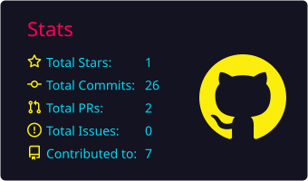
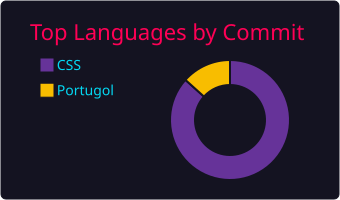
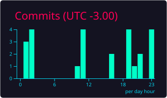

<!-- ═══════════════════════════════════════════════════════════════
     ░█▀▀░█▀█░█▄█░▀█▀░█░░░█▀█░░░█▀█░█▀█░█░█░█▀█░█▀▄░█▀█░█▀▄
     PERFIL GITHUB // CAMILA C. NAKABAR // SYSTEM ONLINE
     Repositório: Camila-nak/Camila-nak
     ═══════════════════════════════════════════════════════════════ -->

<div align="center">

<!-- ░░░ BANNER PRINCIPAL ░░░ -->


<!-- ░░░ SEQUÊNCIA DE INICIALIZAÇÃO (roda uma vez ao carregar) ░░░ -->


<!-- ░░░ TYPING ANIMATION (loop) ░░░ -->
<a href="https://github.com/Camila-nak">
  
</a>

<br/>


<br/><br/>


</div>

<br/>

<!-- ░░░ DIVISOR ░░░ -->


<!-- ░░░ SOBRE MIM ░░░ -->
## `> whoami`

<div align="center">

</div>

```ruby
╔══════════════════════════════════════════════════════════════╗
║  USUÁRIA ......... Camila C. Nakabar                         ║
║  USERNAME ........ Camila-nak                                ║
║  FORMAÇÃO ........ Análise e Desenvolvimento de Sistemas     ║
║  INSTITUIÇÃO ..... Fatec Antônio Russo · São Caetano do Sul  ║
║  LOCALIZAÇÃO ..... Santo André, SP — Brasil                  ║
║  NA PROGRAMAÇÃO .. desde 2025                                ║
║  LINGUAGENS ...... C · C++ · C# · Java · HTML5 · CSS3 · Py   ║
║  MOTOR ........... Curiosidade + paixão por aprender         ║
╚══════════════════════════════════════════════════════════════╝
```

> 🧠 Gosto de **conhecer coisas novas**, explorar diferentes áreas da tecnologia e me aprofundar com **paixão** em cada uma delas.
> Acredito que aprender é um processo contínuo — e que cada linha de código é uma oportunidade de evoluir.

<br/>

<!-- ░░░ TECH STACK ░░░ -->
## `> ./tech_stack --list`

<div align="center">


<br/><br/>


</div>

<br/>

<!-- ░░░ FERRAMENTAS ░░░ -->
## `> ./tools --installed`

<div align="center">


<br/><br/>


</div>

<br/>

<!-- ░░░ PROJETOS ░░░ -->
## `> ls ./projetos`

<!-- ⚠️ Substitua os títulos, descrições e links pelos seus repositórios reais -->
<table align="center">
  <tr>
    <td width="50%" valign="top">
      <h3>⚡ Projeto 01</h3>
      <p>Descreva aqui o que o projeto faz e qual problema ele resolve.</p>
      
      
      <br/><br/>
      <a href="https://github.com/Camila-nak?tab=repositories">
        
      </a>
    </td>
    <td width="50%" valign="top">
      <h3>🌐 Projeto 02</h3>
      <p>Site / aplicação web desenvolvido com HTML5 e CSS3 responsivo.</p>
      
      
      <br/><br/>
      <a href="https://github.com/Camila-nak?tab=repositories">
        
      </a>
    </td>
  </tr>
  <tr>
    <td width="50%" valign="top">
      <h3>🐍 Projeto 03</h3>
      <p>Automação, script ou estudo em Python.</p>
      
      
      <br/><br/>
      <a href="https://github.com/Camila-nak?tab=repositories">
        
      </a>
    </td>
    <td width="50%" valign="top">
      <h3>🧩 Projeto 04</h3>
      <p>Exercícios e algoritmos em C / C++ / C#.</p>
      
      
      <br/><br/>
      <a href="https://github.com/Camila-nak?tab=repositories">
        
      </a>
    </td>
  </tr>
</table>

<br/>

<!-- ░░░ OBJETIVOS (TERMINAL) ░░░ -->
## `> cat objetivos_atuais.sh`

```bash
#!/bin/bash
# ┌──────────────────────────────────────────────┐
# │  MISSION CONTROL  ::  camila@nak-os  ~ $     │
# └──────────────────────────────────────────────┘

camila@nak-os:~$ ./status --current

[✔] Cursando ADS na Fatec Antônio Russo
[✔] Dominando a base: C, C++, C#, Java, Python, HTML5 e CSS3
[⏳] Aprofundando em Programação Orientada a Objetos
[⏳] Construindo projetos reais para o portfólio
[⏳] Explorando novas áreas da tecnologia
[ ] Conquistar o primeiro estágio na área de TI
[ ] Contribuir com projetos open source
[ ] Aprender Banco de Dados, APIs e Cloud a fundo

camila@nak-os:~$ echo $MOTTO
"Sempre aprendendo. Sempre evoluindo."

camila@nak-os:~$ _
```

<br/>

<!-- ░░░ GITHUB STATS ░░░ -->
## `> ./github_analytics --run`

<div align="center">




<br/>


<br/>




</div>

<br/>

<!-- ░░░ SNAKE ░░░ -->
## `> ./snake --contributions`

<div align="center">
  <picture>
    <source media="(prefers-color-scheme: dark)" srcset="https://raw.githubusercontent.com/Camila-nak/Camila-nak/output/github-snake-dark.svg" />
    <source media="(prefers-color-scheme: light)" srcset="https://raw.githubusercontent.com/Camila-nak/Camila-nak/output/github-snake.svg" />
    
  </picture>
</div>

<!-- Requer o workflow .github/workflows/snake.yml (arquivo incluído à parte) -->

<br/>

<!-- ░░░ REDES SOCIAIS ░░░ -->
## `> ./connect --open-channels`

<div align="center">

<a href="https://github.com/Camila-nak"></a>
<a href="https://www.linkedin.com/in/camilacavalcantenakabar/"></a>
<a href="mailto:camilacavalcantenakabar@gmail.com"></a>
<a href="https://www.instagram.com/nakabar.c/"></a>

</div>

<br/>

<!-- ░░░ RODAPÉ ░░░ -->
<div align="center">


<br/>


</div>
